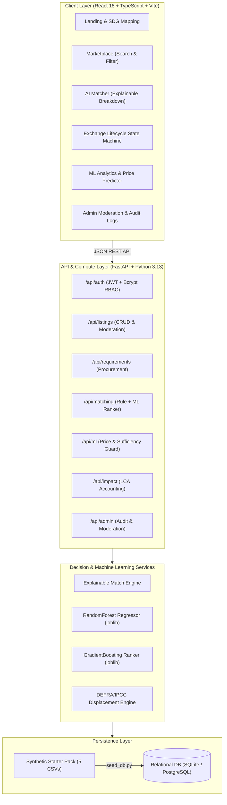

# Waste2Worth AI — AI-Powered Industrial Waste Exchange Marketplace

[](https://github.com/waste2worth-ai/waste2worth)
[](https://www.python.org/)
[](https://fastapi.tiangolo.com/)
[](https://react.dev/)
[](https://www.typescriptlang.org/)
[](https://tailwindcss.com/)
[](https://opensource.org/licenses/MIT)
[](https://sdgs.un.org/goals/goal12)
[](https://sdgs.un.org/goals/goal11)

> **Waste2Worth AI** is a complete, full-stack, GitHub-ready web application engineered to transform industrial manufacturing waste and discarded by-products into high-value secondary raw materials. It connects manufacturing plants with certified recyclers and processors to enable closed-loop industrial symbiosis under **UN Sustainable Development Goal 12 (Responsible Consumption & Production)** and **SDG 11 (Sustainable Cities & Communities)**.

Designed for university final-year capstone demonstrations, technical viva voce evaluation, GitHub publication, and enterprise circularity piloting.

---

## 🌟 Key Features

1. **Industrial Waste Marketplace:**
   - Searchable, filterable directory covering 12 distinct material streams (cotton, polyester, PET, HDPE, paper fiber, wood fiber, biomass, organic biomass, mineral aggregate, ferrous metal, aluminium, glass).
   - Real-time technical filters: available mass, lab purity score ($0-100\%$), estimated contamination cap, asking price, condition, and location.
   - Moderation gate: Newly posted listings automatically enter **Under Review** status until approved by administrators.

2. **Buyer Procurement Requirements:**
   - Allows recycling facilities and secondary manufacturers to publish procurement tolerances, minimum quality assays, maximum contamination thresholds, and budget caps in INR/kg.
   - One-click trigger linking directly to the AI Matching Engine.

3. **Explainable AI Matching Engine:**
   - Multi-criteria decision engine evaluating six transparent weighted dimensions:
     - **Material Category Compatibility (25%)**
     - **Technical Quality Fit (20%)**
     - **Contamination Tolerances (15%)**
     - **Quantity Absorption Window (15%)**
     - **Budget Alignment (15%)**
     - **Geographic Distance Proximity (10%)**
   - Immediate disqualification of hazardous waste lots or materials violating purity constraints.
   - Dual-engine architecture: transparent rule-based baseline alongside a trained Gradient Boosting classification ranker.

4. **Machine Learning & Data Sufficiency Guardrails:**
   - **Indicative Price Regressor:** Cross-validated Random Forest Regressor trained on completed secondary transactions, providing indicative pricing and $95\%$ empirical confidence intervals.
   - **Waste Generation Forecaster:** Enforces a strict **Data Sufficiency Guardrail** requiring $\ge 6$ sequential dated observations before projecting quantities; returns structured diagnostic feedback if history is sparse.
   - **Model Benchmark Suite:** Direct comparative metrics between Logistic Regression baseline and Gradient Boosting ranker ($88.9\%$ accuracy, $0.926$ ROC-AUC).

5. **Role-Based Exchange Lifecycle & Audit Trails:**
   - Full state machine: `Submitted` $\rightarrow$ `Under Review` $\rightarrow$ `Accepted` $\rightarrow$ `In Transit` $\rightarrow$ `Completed` $\rightarrow$ `Disputed`.
   - Role-Based Access Control (RBAC) across **Administrator**, **Waste Supplier**, and **Material Buyer**.
   - Immutable security audit log tracking every user action, listing approval, and status change.

6. **ISO 14040 Environmental LCA Impact Accounting:**
   - Cumulative tracking of diverted secondary mass and avoided greenhouse gas emissions ($\text{t CO}_2\text{e}$).
   - Defensible displacement factors sourced from UK DEFRA & IPCC guidelines with haulage logistics transit deductions.

---

## 🏛️ System Architecture



---

## 📁 Repository Structure

```text
Waste2Worth-AI/
├── .github/
│   └── workflows/
│       └── ci.yml               # GitHub Actions CI workflow (pytest + npm build)
├── backend/
│   ├── app/
│   │   ├── api/deps.py          # JWT authentication and RBAC dependency guards
│   │   ├── core/                # App config, environment settings, and Bcrypt security
│   │   ├── db/                  # SQLAlchemy engine, session maker, and seed_db.py
│   │   ├── models/              # Normalized SQLAlchemy models (User, Listing, Req, Exchange, Audit)
│   │   ├── routers/             # Documented FastAPI route controllers
│   │   ├── schemas/             # Pydantic v2 validation models
│   │   └── main.py              # Application entry point with CORS & startup seeder
│   └── Dockerfile               # Backend container definition
├── datasets/
│   ├── demo_waste_listings.csv               # 180 synthetic sample waste listings
│   ├── demo_buyer_requirements.csv           # 140 synthetic buyer requirement rows
│   ├── synthetic_demo_transactions.csv       # 360 synthetic completed transaction records
│   ├── material_compatibility_reference.csv  # 12 material category reuse matrices
│   ├── ml_feature_data_requirements.csv      # ML input requirement documentation
│   └── README_DATASET.md                     # Dataset documentation and limitations
├── docs/
│   ├── ARCHITECTURE.md          # In-depth system design & Mermaid diagrams
│   ├── DATA_DICTIONARY.md       # Complete field-by-field schema reference
│   ├── VIVA_GUIDE.md            # University evaluation presentation & defense script
│   └── POSTGRES_MIGRATION.md    # Production deployment guide for PostgreSQL
├── frontend/
│   ├── src/
│   │   ├── api/client.ts        # Typed API client with token interception
│   │   ├── components/          # Reusable UI widgets (Navbar, Footer, Modal, ScoreBar, Badge)
│   │   ├── context/AuthContext.tsx # User session & 1-click evaluator demo role switcher
│   │   ├── pages/               # Full responsive application views
│   │   ├── types/index.ts       # TypeScript interface definitions
│   │   ├── App.tsx              # Application layout & navigation controller
│   │   └── main.tsx             # React DOM root mounting
│   ├── package.json
│   ├── vite.config.ts
│   └── tailwind.config.js
├── ml/
│   ├── artifacts/               # Serialized .joblib model binaries
│   ├── compatibility.py         # Cross-stream compatibility rules
│   ├── environmental_impact.py  # LCA displacement calculation engine
│   ├── matching_engine.py       # Transparent multi-criteria scoring algorithm
│   ├── price_predictor.py       # Random Forest regression pipeline
│   ├── quantity_forecaster.py   # Longitudinal time-series data sufficiency guard
│   └── train_all.py             # Model training and benchmark generation script
├── tests/
│   ├── conftest.py              # Pytest fixtures and isolated SQLite test database
│   ├── test_auth.py             # User registration, login, and RBAC tests
│   ├── test_listings.py         # Listing validation and 'Under Review' status tests
│   ├── test_matching.py         # Constraint rejection and scoring tests
│   ├── test_exchanges.py        # Lifecycle transition and audit trail tests
│   └── test_ml.py               # Price prediction, data sufficiency, and LCA tests
├── .env.example                 # Sanitized environment template
├── .gitignore                   # Excludes build caches, .env, and local databases
├── docker-compose.yml           # Full-stack multi-container composition
├── LICENSE                      # MIT Open Source License
├── LIMITATIONS.md               # Scientific disclosure of synthetic data constraints
├── requirements.txt             # Locked Python backend dependencies
└── README.md                    # Project documentation
```

---

## 🚀 Quick Start Guide

### Prerequisites
- **Python 3.11+** (Python 3.13 supported)
- **Node.js 18+** & **npm**

---

### Step 1: Backend Setup & Seed Database

1. **Clone the repository:**
   ```bash
   git clone https://github.com/your-username/Waste2Worth-AI.git
   cd Waste2Worth-AI
   ```

2. **Initialize Python Virtual Environment:**
   - **On Windows (PowerShell):**
     ```powershell
     python -m venv .venv
     .\.venv\Scripts\activate
     ```
   - **On Linux / macOS:**
     ```bash
     python3 -m venv .venv
     source .venv/bin/activate
     ```

3. **Install Dependencies:**
   ```bash
   pip install -r requirements.txt
   ```

4. **Train ML Models & Seed Database:**
   ```bash
   # Windows PowerShell:
   $env:PYTHONPATH="."
   python ml/train_all.py
   python backend/app/db/seed_db.py

   # Linux / macOS:
   PYTHONPATH=. python ml/train_all.py
   PYTHONPATH=. python backend/app/db/seed_db.py
   ```
   *This initializes the SQLite database with 180 listings, 140 requirements, 360 transaction records, and pre-trained `.joblib` machine learning models.*

5. **Start the FastAPI Server:**
   ```bash
   uvicorn backend.app.main:app --reload --port 8000
   ```
   - REST API running at: `http://127.0.0.1:8000`
   - Interactive Swagger API Documentation: `http://127.0.0.1:8000/docs`

---

### Step 2: Frontend Setup & Execution

1. **Open a new terminal window** and navigate to `frontend/`:
   ```bash
   cd frontend
   npm install
   ```

2. **Start the Vite Development Server:**
   ```bash
   npm run dev
   ```
   - Web Application interface running at: `http://localhost:5173`

---

## 🔑 Pre-Configured Demo Personas (Evaluation Credentials)

To facilitate immediate examination and testing, three pre-seeded accounts with complete role-based permissions are accessible directly via the **"Demo Roles"** dropdown in the top navbar:

| Persona | Role | Email | Password | Allowed Capabilities |
| :--- | :--- | :--- | :--- | :--- |
| **Dr. Ananya Sharma** | `admin` | `admin@waste2worth.org` | `AdminPassword123!` | Moderate pending listings, inspect audit logs, resolve disputes, reseed database |
| **Rajesh Patel** | `supplier` | `supplier@waste2worth.org` | `SupplierPassword123!` | Publish industrial scrap lots, accept/reject incoming buyer requisitions, mark in transit |
| **Kavita Rao** | `buyer` | `buyer@waste2worth.org` | `BuyerPassword123!` | Create buyer requirements, run AI matching engine, negotiate exchange terms |

---

## 🧪 Automated Testing & Verification

The test suite runs against an isolated in-memory SQLite fixture to guarantee non-destructive testing:

```bash
# Execute Pytest test suite:
# Windows PowerShell:
$env:PYTHONPATH="."
pytest tests/ -v

# Linux / macOS:
PYTHONPATH=. pytest tests/ -v
```

### Test Coverage Highlights
- `tests/test_auth.py`: JWT token issue, salted Bcrypt validation, role permissions.
- `tests/test_listings.py`: Multi-parameter filtering, validation constraints, default 'Under Review' status.
- `tests/test_matching.py`: Multi-objective scoring, constraint disqualification, ML benchmark endpoints.
- `tests/test_exchanges.py`: Full state machine transition logic and audit trail generation.
- `tests/test_ml.py`: Indicative price inference, **Data Sufficiency Guardrail** enforcement (<6 points rejected, $\ge 6$ points projected), and LCA calculations.

---

## 🐳 Docker Deployment

To launch the full-stack system in isolated containers:

```bash
docker-compose up --build
```
- Frontend available at `http://localhost:5173`
- Backend available at `http://localhost:8000/docs`

---

## 📊 Scientific & Academic Limitations

All users and evaluators should consult [LIMITATIONS.md](LIMITATIONS.md) before interpreting platform metrics. All company names and transaction histories are synthetically generated demo data. Machine learning price predictions are indicative engineering models and do not represent binding market quotes or certified carbon offsets.

---

## 📜 License

This project is open-source under the [MIT License](LICENSE).
