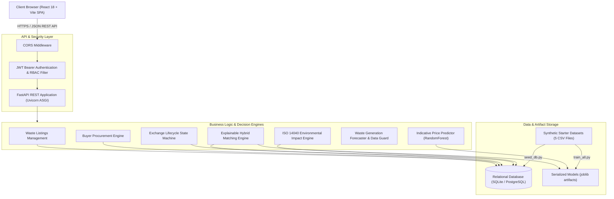

# System Architecture & Technical Design

**Waste2Worth AI** is architected as an asynchronous, decoupled, multi-tier web application designed for high-concurrency industrial marketplace transactions, explainable algorithmic matching, and rigorous environmental accounting.

---

## 1. High-Level Architecture Diagram

---

## 2. Component Breakdown

### A. Frontend Layer (React + TypeScript + Vite + Tailwind CSS)
- **Role-Based Context (`AuthContext`):** Automatically injects authorization headers and provides quick switching between Administrator, Waste Supplier, and Material Buyer personas for Viva Voce examinations.
- **Explainable Matching Visualizer:** Renders real-time breakdown progress bars displaying score weights across Category, Quality, Contamination, Quantity, Budget, and Geographic Proximity.
- **Interactive Environmental Dashboard:** Utilizes Recharts for dynamic visual rendering of diverted mass and avoided greenhouse gases.

### B. Backend REST API Layer (FastAPI + Pydantic v2)
- Built on Python 3.13 utilizing modern asynchronous route handlers.
- Pydantic v2 enforces boundary checking, input sanitization, and type safety before requests reach business logic.
- OpenAPI specification dynamically auto-generated at `/docs` (Swagger UI) and `/redoc`.

### C. Algorithmic Matching Layer (`ml/matching_engine.py`)
- **Baseline Multi-Criteria Scoring:**
  $$\text{Score} = w_{\text{cat}} S_{\text{cat}} + w_{\text{qual}} S_{\text{qual}} + w_{\text{contam}} S_{\text{contam}} + w_{\text{qty}} S_{\text{qty}} + w_{\text{price}} S_{\text{price}} + w_{\text{dist}} S_{\text{dist}}$$
- **Safety Hard Constraints:** Listings flagged with `hazardous_flag=True` or exceeding buyer contamination caps are rejected immediately.
- **Nonlinear ML Ranking:** An ensemble Gradient Boosting Classifier evaluates transaction completion probability based on empirical multi-factor interactions.

### D. Environmental Life Cycle Assessment Engine (`ml/environmental_impact.py`)
- Evaluates virgin raw material displacement:
  $$\text{Diverted Mass} = \text{Transacted Quantity} \times \text{Secondary Yield Fraction}$$
  $$\text{Avoided CO}_2\text{e} = (\text{Diverted Mass} \times \text{Displacement Factor}) - (\text{Diverted Mass} \times \text{Distance} \times 0.00008)$$
